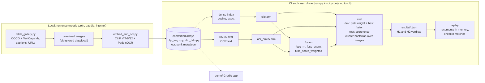

# multimodal-search

> Text-to-image search that can read: CLIP, an OCR text index and their fusion, measured on
> queries about what an image shows and queries about what it says, with the pass rules written
> down before any image was embedded.

[](https://github.com/Prithv122/multimodal-search/actions/workflows/ci.yml)

**Live demo:** not deployed. A local Gradio app is in [`demo/`](demo/README.md).
**Stack:** Python 3.12 · numpy + scipy (index, BM25, fusion, metrics, bootstrap) · CLIP ViT-B/32 via `transformers` · PaddleOCR 3.7 (PP-OCRv5 mobile) · Gradio

**Headline.** Fusing CLIP with OCR text lifted nDCG@10 on the reading slice by +0.066
[+0.054, +0.079] and cost the visual slice 0.008 [0.003, 0.013]. The pre-registered bar for the
reading slice was +0.10, so **H1 failed** and H2 passed. CLIP alone already scored 0.748 on the
reading slice, which is the main finding. Details and caveats in §5.

---

## 1. The problem

A user types a sentence and wants the image it describes. CLIP matches the sentence to what the
picture shows. It is usually said to read text inside images poorly, and an OCR text index has
the opposite profile: it can match a word on a sign and knows nothing about a dog on a beach.
This project measures that gap on a 1,000-image gallery and tests whether fusing the two closes
it without hurting queries that do not need reading.

The question, as written in [`EVAL_PLAN.md`](EVAL_PLAN.md) before any data was embedded: on a
1,000-image gallery, how do CLIP-only, OCR-BM25-only and their fusion compare in nDCG@10 for
queries about visual content versus queries that need reading text in the image, and does the
best fusion beat the best single arm on each slice?

## 2. The data

| | |
|---|---|
| Gallery | 1,000 images: 500 COCO val2017 (the **visual** slice) + 500 TextCaps validation (the **reading** slice), sampled with seed 47 |
| Queries | 5,002 human captions (2,502 COCO, 2,500 TextCaps). Each caption is a query whose one relevant item is its own image |
| Split | By image, stratified by source, seed 47: dev 200 images (1,000 queries), test 800 images (4,002 queries). All captions of an image go with it |
| Licence | Captions: CC BY 4.0 (COCO Consortium; Meta for TextCaps). Images: owned by their Flickr authors and **never committed** |
| Committed | Image ids, captions, URLs, sha256 hashes, OCR text, CLIP vectors. Not committed: any image file |
| Refresh | One-off. Hashes pin every image |

**Slice caveat.** The slice is the source dataset, not the query type. A TextCaps caption can be
fully answerable from what the picture shows. The fix is a hand-tagged subset (§4), which is not
done yet.

**Licence risk.** 382 of the 500 COCO images carry a non-commercial or no-derivatives Flickr
licence. Only text and vectors derived from them are committed, and the licences do not address
that case explicitly. The fallback is written up in [`DATA.md`](DATA.md).

Model facts, from `data/embeddings/meta.json`: CLIP ViT-B/32 OpenAI weights through
`transformers` 5.20.2, CPU, 512 dimensions, vectors L2-normalised; 0 of 5,002 captions were
truncated at CLIP's 77-token limit. OCR is PaddleOCR 3.7.0 PP-OCRv5 mobile detector and
recogniser with no preprocessing. It found some text on 192 of 500 COCO images and 496 of 500
TextCaps images. The OCR pass took about 2.5 hours on a shared, loaded CPU; CLIP took about 8
minutes.

## 3. Architecture



Two stages on purpose. Everything that needs a model runs once on a laptop and writes arrays
into the repository. Everything in `src/mmsearch` replays those arrays, so CI and a clean clone
need only numpy and scipy, and CI asserts that torch is absent. The index, BM25, fusion and
metrics code is vendored from [production-rag](https://github.com/Prithv122/production-rag)
at a pinned commit; each file's header records the provenance.

## 4. Key decisions & tradeoffs

| Decision | Chose | Over | Why |
|---|---|---|---|
| Pipeline shape | Two stages: local embed/OCR writes arrays, package replays them | One pipeline that calls the models | CI never needs a model or a download. Anyone can recompute every number in seconds from the committed arrays |
| Pre-registration | Plan, arms, thresholds and split committed before any data was embedded; test scored once | Tune until the table looks good | The result is allowed to be unflattering. It was |
| Best fusion | Chosen on dev only, then fixed | Report the best of three on test | A best-of-three pick on test would inflate H1. The dev score of the weighted arm is in-sample (its weight was tuned there), which favours it in the pick; that is recorded in the results file |
| Fusion weight | Dev grid 0.00 to 1.00 step 0.05, pooled nDCG@10; chose 0.70 | A fixed 0.5, or tuning per slice | Per-slice weights would use the slice label, which a real query does not have |
| Dataset-as-slice confound | Report by source as pre-registered; hand-tag 100 blind queries as a robustness check | Treat source as query type | A TextCaps caption may not need reading. The tag sheet hides the source. Tags regroup the saved per-query rows, so applying them is not a second look at test |
| Uncertainty | Cluster bootstrap over images (20,000 resamples), paired differences | Bootstrap over queries; report two overlapping intervals | The 5 captions of an image are not independent. Resampling images keeps them together, and pairing both arms on one resample gives the interval of the difference itself |
| Score normalisation | Per-query min-max over each arm's top 100 | Raw scores; z-score | BM25 and cosine live on different scales. Min-max is the vendored fusion's own choice and the weight is tuned on the exact quantity it is later applied to. Its weakness shows in §5 |
| RRF constant | k = 60, untouched | Tune k | k is a pre-registered constant. Tuning it on dev would have been allowed; leaving it shows what the standard setting does |
| Tie-breaking | Per-query hash of (query id, image id), added in Amendment A1 | Image id or file order | Ties are common here and the ids and file order both track the slice. Found by code review on fixtures, before any real number. See [`NOTES.md`](NOTES.md) |
| CLIP library | `transformers`, OpenAI checkpoint | `open_clip_torch` | Same weights. The fast tokenizer reports un-truncated lengths (needed to count the 77-token cutoff) and there is no extra `timm`/`torchvision` dependency |
| OCR model | PP-OCRv5 mobile, no preprocessing | Server models; CLAHE | The gallery images are natural scenes, and the CPU is shared. The mobile pair ran at about 1.3 to 1.7 s per image with 2 to 4 threads. The server pair is a script flag and was not run, so the choice is untested: a larger OCR model may read more. Preprocessing was fixed in the plan before the run |
| Exact search | Brute-force cosine and BM25 | An ANN index | 1,000 vectors. Approximation would add error and a knob to save microseconds |
| Test-set discipline | CLI refuses a second test run; per-query rows saved | Re-run when convenient | Tags and any later regrouping read the saved rows, so test is never re-ranked |

**Synthetic fixtures.** Four generated galleries (`planted`, `null`, `filler`, `shuffled`) test
the pipeline on data where the answer is known: a planted OCR effect must be detected, a null
must not be. They are not measurements of any real system. The `filler` fixture, which gives
captions and OCR text shared common words, predicted that un-weighted fusion would hurt the
visual slice. It did, on real data.

## 5. Results

Everything below is read from `results/test/eval.json` (scored once, code `1d95e87`, committed
in `f7213cb`), `results/dev/eval.json` and `results/test/exploratory.json`. Numbers are rounded
to three decimals. Intervals are 95% cluster-bootstrap intervals over images. The arm names are
in [`EVAL_PLAN.md`](EVAL_PLAN.md).

### Pre-registered verdicts (test split, 800 images, 4,002 queries)

The best fusion was fixed on dev before test was scored: `fuse_score_weighted`, CLIP weight 0.70.
Dev nDCG@10 of the three fusions: RRF 0.503, equal-weight score 0.646, weighted 0.802.

| Check | Rule, as written in the plan | Result | Verdict |
|---|---|---|---|
| **H1**, reading slice | best fusion − `clip` ≥ 0.10 nDCG@10 **and** the 95% interval excludes 0 | **+0.066** [+0.054, +0.079] | **FAIL** |
| **H2**, visual slice | \|best fusion − `clip`\| ≤ 0.02 nDCG@10 (point estimate) | **−0.008** [−0.013, −0.003] | **PASS** |

Reading H1: the interval excludes 0, so the gain is not noise. The size bar fails: the whole
interval lies below 0.10. Reading H2: the point estimate is within 0.02, but the interval sits
entirely below zero, so there is a small real cost on the visual slice, not none.

Second question in the plan, does the best fusion beat the best single arm? The best single arm
on dev was `clip` in every slice. On the reading slice the fusion beats it (+0.066). On the
visual slice it does not (−0.008). Pooled over both slices it does (+0.029 [+0.022, +0.036]).

### Arm × slice, test split

**Visual slice (COCO): 400 images, 2,002 queries**

| Arm | nDCG@10 | recall@1 | recall@10 |
|---|---|---|---|
| `clip` | 0.745 [0.722, 0.768] | 0.566 [0.532, 0.600] | 0.928 [0.911, 0.944] |
| `ocr_bm25` | 0.019 [0.010, 0.029] | 0.013 [0.005, 0.022] | 0.027 [0.016, 0.040] |
| `fuse_rrf` | 0.304 [0.288, 0.321] | 0.039 [0.025, 0.054] | 0.737 [0.708, 0.766] |
| `fuse_score` | 0.518 [0.497, 0.539] | 0.187 [0.165, 0.210] | 0.842 [0.818, 0.866] |
| `fuse_score_weighted` | 0.737 [0.713, 0.760] | 0.550 [0.516, 0.585] | 0.925 [0.907, 0.941] |

**Reading slice (TextCaps): 400 images, 2,000 queries**

| Arm | nDCG@10 | recall@1 | recall@10 |
|---|---|---|---|
| `clip` | 0.748 [0.723, 0.773] | 0.614 [0.580, 0.648] | 0.888 [0.868, 0.907] |
| `ocr_bm25` | 0.419 [0.383, 0.454] | 0.340 [0.305, 0.375] | 0.509 [0.470, 0.546] |
| `fuse_rrf` | 0.662 [0.629, 0.695] | 0.553 [0.515, 0.591] | 0.796 [0.767, 0.825] |
| `fuse_score` | 0.764 [0.738, 0.789] | 0.624 [0.588, 0.659] | 0.899 [0.879, 0.919] |
| `fuse_score_weighted` | 0.815 [0.792, 0.837] | 0.717 [0.686, 0.748] | 0.915 [0.897, 0.932] |

Paired differences from `clip` in nDCG@10 (the interval is for the difference itself):

| Fusion − `clip` | Visual | Reading | Pooled |
|---|---|---|---|
| `fuse_rrf` | −0.440 [−0.458, −0.422] | −0.086 [−0.118, −0.055] | −0.263 [−0.286, −0.241] |
| `fuse_score` | −0.227 [−0.239, −0.214] | +0.016 [−0.005, +0.036] | −0.105 [−0.120, −0.091] |
| `fuse_score_weighted` | −0.008 [−0.013, −0.003] | +0.066 [+0.054, +0.079] | +0.029 [+0.022, +0.036] |

On recall@1 the weighted fusion gains +0.103 [+0.083, +0.125] on the reading slice and loses
0.015 [0.005, 0.026] on the visual slice. Pooled nDCG@10: `clip` 0.747 [0.730, 0.764], weighted
fusion 0.776 [0.759, 0.792]. MRR@100 and recall@5 are in the results file.

What the table says:

- **CLIP reads well enough on this data.** nDCG@10 is 0.748 on the reading slice and 0.745 on
  the visual slice. The premise that CLIP fails on text-heavy queries is not visible here.
- **OCR-BM25 alone is a weak arm that works only where there is text:** 0.419 on the reading
  slice, 0.019 on the visual slice.
- **Plain RRF and equal-weight fusion hurt.** RRF is below CLIP on both slices; equal-weight
  score fusion costs 0.227 on the visual slice. Only the weighted fusion, with a dev-tuned
  weight that leans on CLIP, is near CLIP on the visual slice and above it on the reading slice.

### Dev versus test

The weight (0.70) and the best fusion were chosen on dev, so dev numbers are in-sample for the
weighted arm. On dev, the same checks gave reading +0.039 [+0.021, +0.058] and visual −0.007
[−0.015, +0.002]; the dev sweep is flat from weight 0.60 to 0.85 (pooled nDCG@10 between 0.792
and 0.802). Dev has only 100 images per slice, so its intervals are wide. The test gain
(+0.066) is larger than the dev gain (+0.039). I read that as noise in a 200-image dev set, not
as evidence of over-fitting, and do not claim more than that.

### Exploratory, post hoc, not pre-registered

Labelled as such in `scripts/explore.py` and `results/test/exploratory.json`. It only regroups
the saved per-query rows and counts shared tokens; it ranks nothing new. A "hit" is the query's
own image in the top 10. Treat these as descriptions that suggest an explanation, not tests.

| Question | Visual (2,002 queries) | Reading (2,000 queries) |
|---|---|---|
| `clip` and `ocr_bm25` both hit | 51 (0.025) | 948 (0.474) |
| Only `clip` hits | 1,807 (0.903) | 828 (0.414) |
| Only `ocr_bm25` hits | 3 (0.001) | 70 (0.035) |
| Neither hits | 141 (0.070) | 154 (0.077) |
| Weighted fusion rescues a `clip` miss | 2 of 144 (0.014) | 59 of 224 (0.263) |
| Weighted fusion breaks a `clip` hit | 9 of 1,858 (0.005) | 5 of 1,776 (0.003) |
| RRF breaks a `clip` hit | 386 of 1,858 (0.208) | 273 of 1,776 (0.154) |
| RRF rescues a `clip` miss | 4 of 144 (0.028) | 90 of 224 (0.402) |
| Queries sharing a token with the OCR text of *some* gallery image | 2,002 (1.000) | 2,000 (1.000) |
| Queries sharing a token with their *own* image's OCR text | 86 (0.043) | 1,423 (0.712) |

- **Why the reading gain is small.** OCR finds a hit that CLIP misses on only 70 of 2,000
  reading queries (0.035). There are 224 CLIP misses; the weighted fusion rescues 59 and breaks
  5. The ceiling for this OCR is low because CLIP already gets most of the queries.
- **Why RRF hurts the visual slice.** OCR "returns something" for every caption. Every COCO test
  caption shares at least one token with the OCR text of some gallery image (median 102 images
  per query), even though only 0.043 share one with their own image. The most common shared
  tokens are function words: "a" appears in 1,770 COCO test captions and in the OCR text of 72
  gallery images. RRF uses ranks only, so a spurious OCR rank 1 counts as much as CLIP's rank 1;
  it broke 386 of 1,858 CLIP hits. Score fusion with a CLIP-heavy weight discounts that list.
  This matches what the `filler` fixture predicted; this analysis does not prove the mechanism.
- **OCR coverage.** Text was found on 192 of 500 COCO images (0.384) and 496 of 500 TextCaps
  images (0.992). On the reading slice, the gold image of 1,985 test queries has OCR text; CLIP
  hits 0.889 of those, and the weighted fusion gains +0.067 nDCG@10 on them over CLIP.

### What this does not show

- **Not that OCR is useless.** It shows that on 1,000 images with caption queries, CLIP ViT-B/32
  already handles most of what OCR could add.
- **Not a query-type result.** The reading slice is TextCaps captions, not queries tagged as
  needing text. The 100 blind hand tags (a robustness check) are not done, so I cannot say how
  the fusion behaves on queries that truly need reading. On those it may well help more.
- **Not an OCR quality result.** OCR word recall on a hand-checked sample has not been done. The
  only coverage figure is the share of images with any OCR text, which includes false text on
  natural scenes.
- **Not a scale result.** 1,000 images is an easy gallery; absolute scores fall as it grows.
- **Not a realistic-query result.** Captions are written to describe the image, which is the
  text style CLIP was trained on. Real search queries are shorter and vaguer.
- **Small-sample caveats.** The weight was tuned on 200 dev images and treated as fixed when
  computing test intervals, so those intervals do not include the uncertainty of that choice.
  Each query has one relevant image, so a caption that fits several images is scored as a
  miss, equally for all arms.
- **No speed result.** Latency was not measured.

## 6. How to run

From a clean clone. No models and no downloads are needed for these.

```bash
uv sync
uv run mmsearch stats
```

Recompute the committed test results in memory and check that they match the files on disk. It
writes nothing and does not score the test split a second time.

```bash
uv run mmsearch replay
```

A faster check with fewer bootstrap resamples (compares means, not intervals):

```bash
uv run mmsearch replay --resamples 2000
```

Score the dev split (the default) and print the table:

```bash
uv run mmsearch eval
```

The test split is scored once. `uv run mmsearch eval --split test` writes
`results/test/eval.json` and refuses to run again once that file exists. The regrouping by hand
tags, once `data/tags.csv` exists, is `uv run mmsearch tagged`.

Search with a stored caption's embedding (no model needed):

```bash
uv run mmsearch search "Three teddy bears, each a different color, snuggling together." --arm fuse_score_weighted --weight 0.7 --query-qid coco-637709
```

Rebuild the exploratory table:

```bash
uv run python scripts/explore.py
```

Tests and lint:

```bash
uv sync --all-groups
uv run pytest
uv run ruff check .
```

### Local-only stages (rebuild the data; heavy)

These need the `embed` extra (torch, transformers, PaddleOCR), an internet connection and about
2.5 hours for OCR on a CPU.

```bash
uv run python scripts/fetch_gallery.py select
uv run python scripts/fetch_gallery.py download
uv run --extra embed python scripts/embed_and_ocr.py --dry-run
uv run --extra embed python scripts/embed_and_ocr.py --only all
uv run python scripts/embed_and_ocr.py --verify
```

### Demo

```bash
uv run --extra embed --extra demo python demo/app.py
```

See [`demo/README.md`](demo/README.md). It runs locally on `127.0.0.1:7860`; your browser loads
each image from its original host.

## 7. What I'd change at 100× scale

- **Replace exact search with an approximate index** (HNSW or IVF-PQ) once the gallery is large
  enough that scanning every vector costs more than the approximation error. At 1,000 vectors
  exact search is the right choice. At 100,000 images the same arithmetic still works; at 100
  million it does not.
- **OCR cost dominates.** It took about 2.5 hours for 1,000 images on a loaded CPU, against
  about 8 minutes for CLIP. At scale: batch the detector and recogniser on a GPU, skip images
  where a cheap text detector finds nothing (only 192 of 500 COCO images had any text), and run
  OCR once at ingest, never at query time.
- **Batch the CLIP image encoder on a GPU** and cache vectors by content hash, as the embedding
  script already does.
- **Fix the caption-as-query bias.** Build a query set from real search logs or from short,
  human-written intents, not from captions, and re-measure; CLIP's advantage here is partly the
  style match.
- **Per-query adaptive weighting or a learned fusion.** One global weight leans on CLIP because
  most queries need no reading. A small model on query features (does the query contain a
  quoted string, a brand, a number?) could choose the weight per query, or a learned ranker
  could replace the weighted sum. This needs labelled data and its own pre-registered test.
- **A larger CLIP.** ViT-B/32 is the smallest common variant. Whether a bigger model closes the
  remaining reading gap on its own is an obvious next measurement.

## References

- Radford et al., "Learning Transferable Visual Models From Natural Language Supervision"
  (CLIP), ICML 2021. OpenAI weights through the Hugging Face checkpoint
  `openai/clip-vit-base-patch32` (MIT).
- Lin et al., "Microsoft COCO: Common Objects in Context", ECCV 2014. Annotations CC BY 4.0.
- Sidorov et al., "TextCaps: a Dataset for Image Captioning with Reading Comprehension",
  ECCV 2020. Annotations CC BY 4.0.
- Kuznetsova et al., "The Open Images Dataset V4", IJCV 2020 (source of the TextCaps images).
- PaddleOCR 3.x, PP-OCRv5 (Baidu PaddlePaddle), Apache-2.0.
- Cormack, Clarke and Büttcher, "Reciprocal Rank Fusion outperforms Condorcet and individual
  Rank Learning Methods", SIGIR 2009.
- Index, BM25, fusion and metrics code vendored from
  [production-rag](https://github.com/Prithv122/production-rag) at `0af3b59`.

More: [`EVAL_PLAN.md`](EVAL_PLAN.md) (pre-registration and Amendment A1),
[`DATA.md`](DATA.md) (sources, terms, hashes), [`NOTES.md`](NOTES.md),
[`INTERVIEW.md`](INTERVIEW.md).
